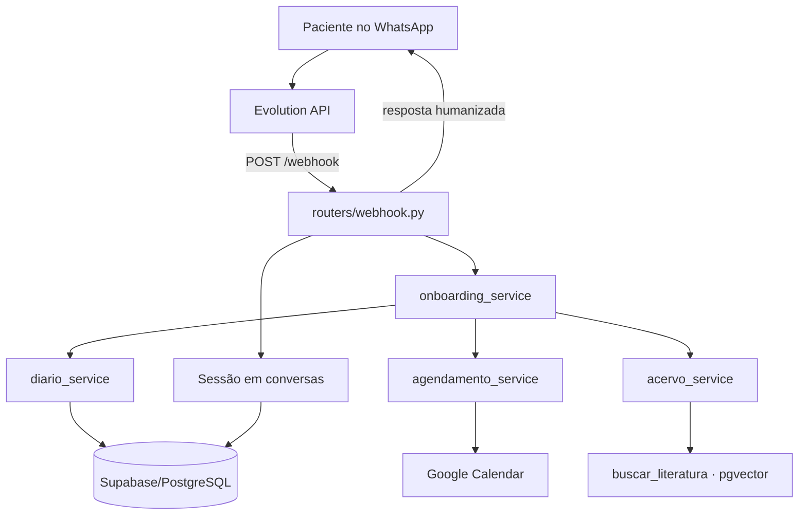

# CLAW — Assistente Clínico Digital


[](https://github.com/teeagohenrique/claw-assistente-clinico/actions/workflows/ci.yml)


Assistente clínico que conduz a jornada do paciente pelo WhatsApp: acolhimento,
consentimento, agendamento, acompanhamento terapêutico, diário reflexivo e
psicoeducação com busca semântica (RAG).

> **Versão de demonstração (white-label).** Este repositório é uma vitrine
> técnica. Nomes de clínica e médico foram substituídos, não há dados de
> pacientes, credenciais ou material comercial.

---

## O problema

Clínicas de saúde mental perdem continuidade terapêutica entre consultas:
o paciente sai da sessão sem canal estruturado, a equipe não consegue medir
adesão e o acompanhamento vira dependência de lembretes manuais.

O CLAW resolve isso com um canal único no WhatsApp, que:

- acolhe e registra consentimento de forma rastreável (LGPD);
- organiza dois percursos de cuidado — consulta isolada e acompanhamento contínuo;
- permite registro diário reflexivo, com limite de um relato por dia;
- responde dúvidas com base na literatura da própria clínica, sem inventar;
- entrega à equipe médica apenas o que precisa de decisão humana.

---

## Funcionalidades

| Frente | O que faz |
| :--- | :--- |
| **Onboarding** | Cadastro, termo de consentimento versionado e direcionamento. |
| **Agendamento** | Slots na agenda, buffer de 30 min, aprovação humana via `APROVAR`/`RECUSAR`. |
| **Continuidade** | Valida vínculo, status e vencimento a cada acesso a recurso exclusivo. |
| **Diário reflexivo** | Um relato por dia, com prazo de guarda e liberação explícita ao médico. |
| **Acervo (RAG)** | Busca vetorial no material da clínica (`pgvector`) com resposta educativa. |
| **Administração** | Notificações para médico e TI por WhatsApp. |

---

## Arquitetura



**Stack:** Python 3.11+ · FastAPI · Supabase (PostgreSQL + pgvector) ·
OpenAI (`gpt-4o-mini` + `text-embedding-3-small`) · Evolution API ·
Google Calendar API.

**Padrões aplicados**

- separação `routers` (transporte) → `services` (domínio) → `core` (infra);
- nomenclatura centralizada em um único módulo (`core/nomenclatura.py`);
- estado da conversa persistido, resistente a reinício do processo;
- integrações externas isoladas e testáveis sem rede;
- respostas sempre educativas: a IA não diagnostica nem prescreve.

Detalhes em [`docs/ARQUITETURA.md`](docs/ARQUITETURA.md).

---

## Segurança e conformidade

- **Consentimento versionado**: registro em dois pares de campos para
  compatibilidade de schema, além de `versao_termo`.
- **Prontuário preservado**: sem expurgo automático do diário; a rotina de
  exclusão é removida por migração (CFM 1.821/2007 e LGPD).
- **Acesso revalidado**: vencimento, suspensão ou falta de consentimento
  bloqueiam recursos exclusivos mesmo em sessões antigas.
- **Segredos fora do Git**: apenas `.env.example` é versionado.
- **Webhook autenticado** por token.
- **Limite clínico explícito**: sem diagnóstico, prescrição ou conduta; casos de
  risco são encaminhados para CVV 188 / SAMU 192.

---

## Estrutura

```text
.
├── main.py                  # aplicação FastAPI e healthcheck
├── agenda.py                # Google Calendar (slots, buffer, fuso)
├── core/                    # configuração, nomenclatura e segurança
├── routers/                 # webhook do WhatsApp e comandos administrativos
├── services/                # domínio: onboarding, agenda, diário, acervo
├── scripts/
│   ├── ingest_acervo.py     # ingestão idempotente com embeddings
│   └── setup.ps1
├── db/                      # schema de referência, migrações e verificação
├── docs/                    # arquitetura
├── tests/                   # 23 testes offline
├── requirements*.txt
└── .env.example
```

---

## Como executar

```bash
# 1. ambiente
python -m venv venv
source venv/bin/activate        # Windows: .\venv\Scripts\activate
pip install -r requirements-dev.txt

# 2. configuração
cp .env.example .env            # preencha com suas credenciais

# 3. banco (SQL Editor do Supabase)
#    db/migrations/001_align_rag.sql
#    db/migrations/002_remove_expurgo_diario.sql
#    db/verify.sql

# 4. acervo (opcional)
pip install -r requirements-ingest.txt
python scripts/ingest_acervo.py --source acervo --dry-run
python scripts/ingest_acervo.py --source acervo

# 5. aplicação
uvicorn main:app --reload
```

Webhook: `POST /webhook` · Healthcheck: `GET /`.

### Qualidade

```bash
pytest -q        # 23 testes, sem dependência de rede
ruff check .
```

---

## Decisões de projeto

| Decisão | Racional |
| :--- | :--- |
| Nomenclatura em módulo único | Evita divergência entre WhatsApp, notificações e documentação. |
| Revalidar acesso a cada recurso | Impede acesso residual após vencimento ou suspensão. |
| ID determinístico na ingestão | Reingestão idempotente, sem duplicar chunks. |
| Limiar de similaridade explícito no RAG | O padrão descartava trechos pertinentes. |
| Sem expurgo automático do prontuário | Obrigação legal de retenção. |
| Google Calendar em `America/Recife` | Alinha slots ao horário real da clínica. |

---

## Aviso

Projeto de engenharia para uso por profissionais de saúde. Não substitui
avaliação clínica e não fornece diagnóstico. Todo conteúdo psicoeducativo é
educativo e reflexivo.

Código proprietário — todos os direitos reservados. Não é concedida licença de
uso, cópia ou distribuição.
